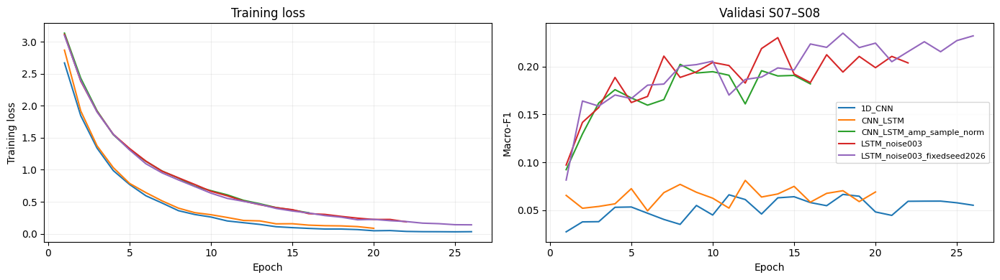
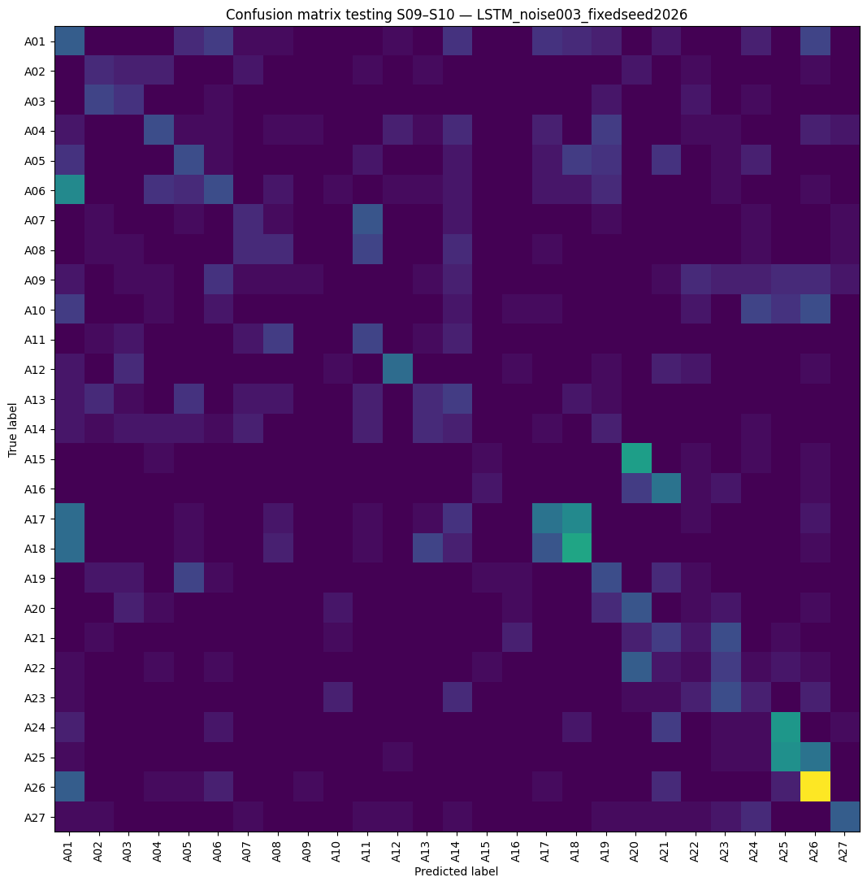

# WiFi CSI Human Activity Recognition (MM-Fi E01)

Repository project pengganti UTS **Pembelajaran Mesin Lanjut** — **Kelompok 4**.  
Track yang dipilih: **Track D (Cross-Domain / Cross-Environment Sensing)**, dengan fokus pengujian **cross-subject**.

Project ini menggunakan data WiFi Channel State Information (CSI) untuk mengklasifikasikan **27 aktivitas manusia**. Kami menggunakan dataset **MM-Fi environment E01** dan membandingkan model **1D-CNN** dengan **CNN-LSTM** menggunakan PyTorch.

Kode eksperimen awal ada di [notebook Google Colab](notebooks/Project_UTS_PML_Kel4.ipynb). Kode yang dipisahkan menjadi beberapa file Python tersedia di folder `src/`.

## Isi repository

``` text
wifi-csi-deep-learning-uts/
├── notebooks/
│   └── Project_UTS_PML_Kel4.ipynb   # Notebook eksperimen di Colab
├── src/
│   ├── config.py                        # Konfigurasi dan pembagian data
│   ├── preprocessing.py                 # Preprocessing CSI
│   ├── data_loader.py                   # Membaca data hasil preprocessing
│   ├── models.py                        # Model 1D-CNN dan CNN-LSTM
│   ├── experiments.py                   # Konfigurasi percobaan
│   ├── train.py                         # Training model
│   ├── evaluate.py                      # Evaluasi dan confusion matrix
│   ├── predict.py                       # Prediksi satu sampel
│   ├── visualize.py                     # Visualisasi hasil
│   └── make_demo_data.py                # Data contoh untuk uji program
├── results/                             # Grafik dan tabel dari notebook
├── train.py                             # Perintah training dari folder utama
├── requirements.txt
└── README.md
```

## Dataset dan preprocessing

Dataset yang digunakan adalah **MM-Fi E01**. Pembagian data dilakukan berdasarkan subjek:

- **Training:** S01–S06 (2.820 sampel)
- **Validasi:** S07–S08 (798 sampel)
- **Testing:** S09–S10 (884 sampel)

Total data yang digunakan adalah **4.502 segmen**. Data testing berasal dari subjek yang tidak dipakai saat training.

Preprocessing di `src/preprocessing.py` meliputi pembacaan amplitude dan phase CSI, perbaikan nilai tidak valid, pengurangan noise dengan median dan filter Butterworth, serta *phase unwrapping* dan *linear detrend*. Setiap segmen kemudian diubah menjadi tensor berukuran **(684, 32)** dan dinormalisasi menggunakan statistik data training. Pada beberapa eksperimen, amplitude juga dinormalisasi per sampel.

## Cara menjalankan

Gunakan **Python 3.10 atau lebih baru**. Semua perintah berikut dijalankan dari folder utama repository.

### 1. Instal library

``` bash
python -m pip install -r requirements.txt
```

### 2. Siapkan dataset MM-Fi

Buat folder `data/input/` dan masukkan file:

``` text
data/input/
├── E01.zip
└── MMFi_action_segments.csv
```

Dataset asli tidak diunggah ke GitHub. File tersebut perlu disiapkan secara terpisah.

Jalankan preprocessing:

``` bash
python -m src.preprocessing --data-dir data/input --raw-dir data/raw_tmp --out-dir data/processed
```

Hasilnya disimpan sebagai `data/processed/processed_E01_v1.npz`. Jika file hasil preprocessing dari Colab sudah tersedia, langkah ini bisa dilewati dengan menempatkan file tersebut di lokasi yang sama.

**Perhatian:** `data/raw_tmp/` adalah folder ekstraksi sementara yang isinya dibersihkan saat preprocessing dijalankan.

### 3. Training model

Untuk membandingkan 1D-CNN dan CNN-LSTM dengan pengaturan input `amplitude_norm`:

``` bash
python train.py --group tuning --experiment CNN_ampnorm_fair
python train.py --group main --experiment CNN_LSTM_amp_sample_norm
```

Untuk melatih konfigurasi CNN-LSTM dengan Gaussian noise 0,03 dan seed 2026:

``` bash
python train.py --group seed --experiment LSTM_noise003_fixedseed2026
```

Pengaturan default training adalah 40 epoch, batch size 64, dan *early stopping* dengan patience 8. Checkpoint disimpan di `models/checkpoints/`.

### 4. Evaluasi dan prediksi

Contoh evaluasi kedua arsitektur pada data testing, setelah checkpoint keduanya tersedia:

``` bash
python -m src.evaluate --checkpoint models/checkpoints/main/CNN_LSTM_amp_sample_norm_best.pth --compare-checkpoint models/checkpoints/tuning/CNN_ampnorm_fair_best.pth --split test
```

Evaluasi model dengan Gaussian noise:

``` bash
python -m src.evaluate --checkpoint models/checkpoints/tuning/LSTM_noise003_fixedseed2026_best.pth --split test
```

Demo prediksi satu sampel testing:

``` bash
python -m src.predict --checkpoint models/checkpoints/tuning/LSTM_noise003_fixedseed2026_best.pth --index 0
```

Hasil evaluasi baru, termasuk metrik dan confusion matrix, disimpan di `results/generated/`.

### 5. Mencoba program tanpa dataset asli

Untuk mengecek alur program, tersedia data sintetis:

``` bash
python -m src.make_demo_data --out-dir data/demo/input
python -m src.preprocessing --data-dir data/demo/input --raw-dir data/demo/raw_tmp --out-dir data/demo/processed
python train.py --data data/demo/processed/processed_E01_v1.npz --out-dir data/demo/ckpt --experiment CNN_LSTM_amp_sample_norm --epochs 5 --patience 3
python -m src.evaluate --data data/demo/processed/processed_E01_v1.npz --checkpoint data/demo/ckpt/main/CNN_LSTM_amp_sample_norm_best.pth --split test --out-dir data/demo/results
python -m src.predict --data data/demo/processed/processed_E01_v1.npz --checkpoint data/demo/ckpt/main/CNN_LSTM_amp_sample_norm_best.pth --index 0
```

**Data sintetis hanya digunakan untuk mencoba program, bukan untuk menilai performa model pada dataset MM-Fi.**

## Hasil eksperimen

Berikut hasil yang tercatat pada notebook Colab asli.

| Model                                 | Macro-F1 validasi |
|---------------------------------------|------------------:|
| 1D-CNN (`CNN_ampnorm_fair`)           |            17,93% |
| CNN-LSTM (`CNN_LSTM_amp_sample_norm`) |            20,23% |

Kedua model pada tabel di atas dibandingkan dengan pengaturan input `amplitude_norm` dan seed 42. CNN-LSTM mendapatkan hasil validasi lebih tinggi pada percobaan tersebut.

Konfigurasi **CNN-LSTM + Gaussian noise 0,03 (seed 2026)** memperoleh:

- **Accuracy testing:** 23,30%
- **Macro-F1 testing:** 21,11%
- **Macro-F1 validasi:** 23,49%

Hasil testing masih cukup rendah, sehingga model belum konsisten mengenali aktivitas pada subjek yang berbeda.

**Grafik training dan validasi**

<figure>

<figcaption aria-hidden="true">Grafik training dan validasi</figcaption>
</figure>

**Confusion matrix testing**

<figure>

<figcaption aria-hidden="true">Confusion matrix testing</figcaption>
</figure>

Tabel eksperimen lainnya dapat dilihat di [results/perbandingan_validasi.md](results/perbandingan_validasi.md).

## Catatan

- Hasil dan grafik di atas berasal dari **output notebook Colab asli**, bukan hasil menjalankan ulang seluruh eksperimen melalui script modular.
- Dataset MM-Fi dan checkpoint model tidak disertakan di repository, sehingga training dengan data asli perlu dijalankan terlebih dahulu sebelum evaluasi atau prediksi.
- Pengujian Track D pada project ini berfokus pada **perbedaan subjek dalam environment E01**, belum pada perpindahan antar-environment atau metode domain adaptation khusus.

## Anggota Kelompok 4

| Nama             | NIM        |
|------------------|------------|
| Ochi Diza Inanta | 2311511006 |
| Mifta Riri Amela | 2311511012 |
| Andi Tri Akira   | 2311513022 |
| Rintan Amorade   | 2311513044 |

## Referensi

- [Awesome-WiFi-CSI-Sensing](https://github.com/NTUMARS/Awesome-WiFi-CSI-Sensing)
- Dataset MM-Fi
